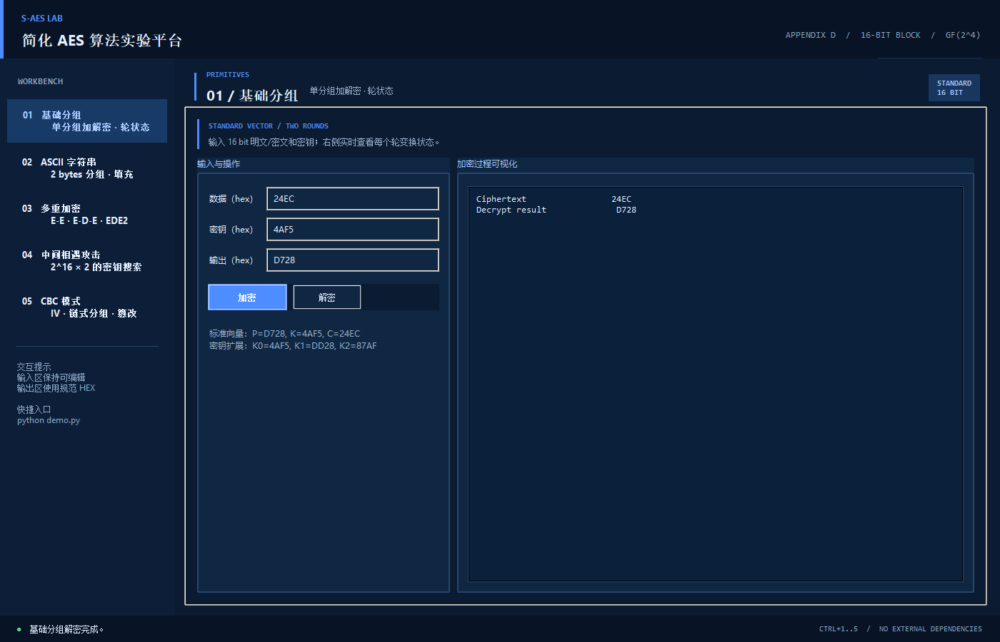
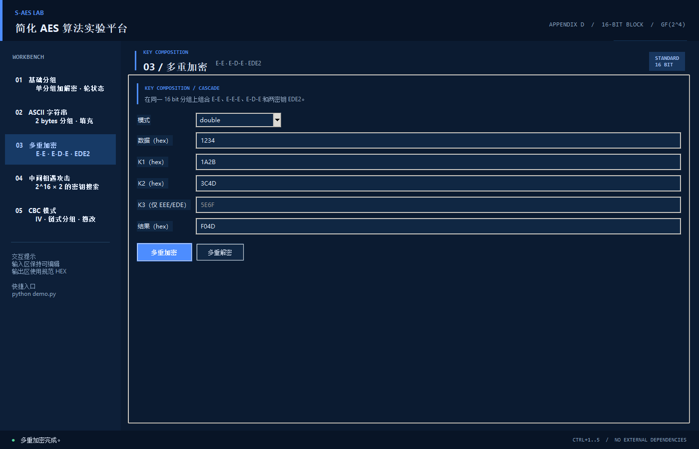

# 测试结果

## 测试环境

测试日期：2026-10-27。环境：Windows、Python 3.13.7、Tkinter/ttk。
本地自动化测试共 21 项，全部通过，无跳过项；交叉测试共 1206 组，全部通过。

- [自动化测试原始日志](tests/validation/unittest.txt)
- [算法演示原始日志](tests/validation/demo.txt)
- [交叉测试完整报告](tests/cross-test/report.md)、[逐条 CSV](tests/cross-test/results.csv)、[环境及版本指纹](tests/cross-test/metadata.json)

截图尺寸为1400×900。界面左侧编号是功能页编号，不完全对应作业关卡：交叉测试独立运行，多重加密和 MITM 同属第4关。

## 第1关：基本测试

操作：在基础分组页输入明文和密钥，点击加密；将密文填回数据框，保持密钥不变，再解密。

| 项目 | 输入 | 预期结果 | 实际结果 | 判定 |
| --- | --- | --- | --- | --- |
| 加密 | P=D728，K=4AF5 | 24EC | 24EC | PASS |
| 解密 | C=24EC，K=4AF5 | D728 | D728 | PASS |
| 教材密钥扩展 | K=2D55 | 2D55、BCE9、A34A | 一致 | PASS |
| 教材变换示例 | 8A1C 经 NS→SR→MC | 604C→6C40→3743 | 一致 | PASS |

图1：基础加密与轮状态。


图2：使用相同密钥解密还原 D728。



## 第2关：交叉测试

A 为本项目 Python 实现，B 为另一组 C++ 项目中的 `saes.exe`。双方在本机运行；使用对方现成可执行文件，未重新编译，文件 SHA-256 已保存。

每组检查三个条件：A/B 加密结果相同，B 解密 A 密文得到原文，A 解密 B 密文得到原文。

| 模式 | 样本构成 | 数量 | 失败数 |
| --- | --- | ---: | ---: |
| 基础 S-AES | 6组固定输入＋1000组随机输入 | 1006 | 0 |
| 双重加密 | 随机输入 | 100 | 0 |
| 三重 EEE | 随机输入 | 100 | 0 |

随机种子为 `20261027`；合计 1206 组、3618 项比较均通过。固定样本结果如下。

| P | K | A密文 | B密文 | B解密A密文 | A解密B密文 |
| --- | --- | --- | --- | --- | --- |
| D728 | 4AF5 | 24EC | 24EC | D728 | D728 |
| 0000 | 0000 | 071E | 071E | 0000 | 0000 |
| FFFF | FFFF | 5343 | 5343 | FFFF | FFFF |
| 0001 | 0001 | CE07 | CE07 | 0001 | 0001 |
| 1234 | ABCD | AB86 | AB86 | 1234 | 1234 |
| 80F0 | 0F08 | 9144 | 9144 | 80F0 | 80F0 |

复现命令（在项目目录执行，路径替换为对方项目实际位置）：

```text
python cross_test.py --peer-dir "D:/cNew/s-aes-main/s-aes-main"
```

边界说明：双方 ASCII/CBC 填充不同，本项目采用 PKCS#7，对方采用奇数长度补零，因此不宣称这些原始接口直接兼容。未测试对方 EDE/EDE2 或 MITM；也未独立确认其二进制与随附源码完全对应。以上基础交叉结果不受字符串填充差异影响。

## 第3关：ASCII 扩展

操作：ASCII 页输入 `S-AES demo`、密钥 `4AF5`，先加密，再对生成的密文解密。

| 项目 | 实际结果 |
| --- | --- |
| 明文 | `S-AES demo` |
| 密钥 | `4AF5` |
| 密文 HEX | `227902476278908FD6F4D35D` |
| 解密结果 | `S-AES demo` |
| 判定 | 与原文一致，PASS |

每组2字节；明文长10字节，添加 `02 02` 填充后得到12字节密文。HEX用于无损复制，界面同时显示可打印字符和不可打印字节的转义形式。空文本、奇偶长度、尾部零字节和非 ASCII 输入由自动化测试覆盖。


## 第4关：多重加密与中间相遇攻击

### 4.1 双重与三重加解密

公共输入：P=`1234`，K1=`1A2B`，K2=`3C4D`，K3=`5E6F`。double、ede2不使用K3。

| 模式 | 总密钥长度 | 实测密文 | 实测解密结果 | 判定 |
| --- | --- | --- | --- | --- |
| double（E-E） | 32 bit | F04D | 1234 | PASS |
| eee（E-E-E） | 48 bit | 6C0F | 1234 | PASS |
| ede（E-D-E） | 48 bit | 5284 | 1234 | PASS |
| ede2（K1-K2-K1） | 32 bit | 3044 | 1234 | PASS |

上述固定结果及逆运算由 `test_double_and_triple_modes` 验证。GUI 复现时先加密，将结果复制回数据框后点击多重解密。

图4：双重加密。



图5：三重 EEE 加密。


图6：三重 EEE 解密，6C0F 恢复为1234。


### 4.2 中间相遇攻击

输入同一双重密钥生成的三个明密文对：

| 明文 | 密文 |
| --- | --- |
| 1234 | F04D |
| BEEF | 62E6 |
| CAFE | 8ACE |

实际搜索得到1个候选：`K1=1A2B，K2=3C4D`，与生成这些数据的密钥一致，PASS。
完整搜索先枚举全部K1，再枚举K2并验证匹配候选。两端枚举共 `2^16 + 2^16` 次 S-AES 调用，另有候选验证开销。单个明密文对不保证唯一恢复密钥；本例通过三个不同明文过滤候选。


## 第5关：CBC 工作模式及篡改实验

输入明文 `CBC tamper demonstration`、密钥 `4AF5`、IV `1234`。为便于复现，此例固定IV；界面也支持随机生成16位IV，并提示解密双方共享。

| 项目 | 实际结果 |
| --- | --- |
| 原始密文 | `3ECE88E2E2ED80508D19AF150729A8DD813D07A46EEB2B9E663D` |
| 篡改位置 | 第0个密文分组，异或掩码 `0001` |
| 篡改后密文 | `3ECF88E2E2ED80508D19AF150729A8DD813D07A46EEB2B9E663D` |
| 原始解密 | `CBC tamper demonstration` |
| 篡改解密 | `SFC!tamper demonstration` |

分组观察：首个明文分组 `CB` 变成 `SF`，下一分组 `C ` 变成 `C!`，后续明文保持不变。符合 CBC 关系 `P_i=D_K(C_i) XOR C_(i-1)`：修改密文组会改变当前明文组，并将相同掩码传播至下一明文组。

自动化测试还验证内部组篡改时前后其他组不变，以及填充遭破坏时明确拒绝解密。判定：PASS。


## 补充测试与结论

现有21项自动化测试包括：教材原语与固定向量、分组往返、ASCII/CBC边界和错误填充、多重加密、MITM恢复/取消/上限、字节显示转义，以及4项CBC界面状态回归。重新加密或操作失败后不会混合显示旧结果。

第1、3、4、5关附GUI运行截图，第2关附逐条CSV及版本信息。测试结论限于报告列出的环境、样本和模式。
