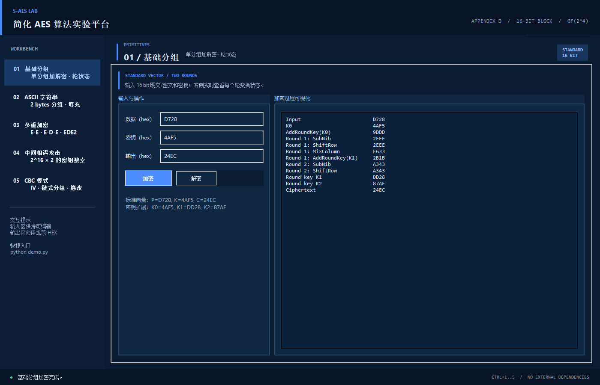
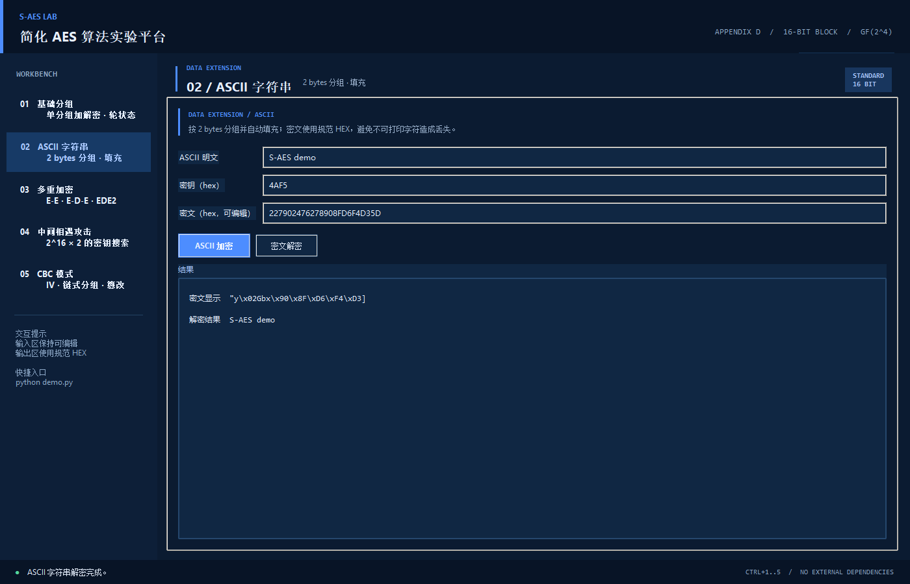
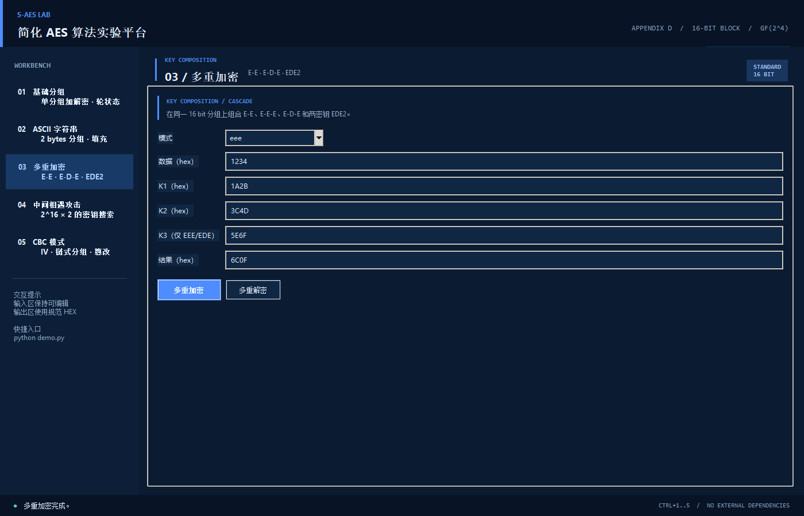
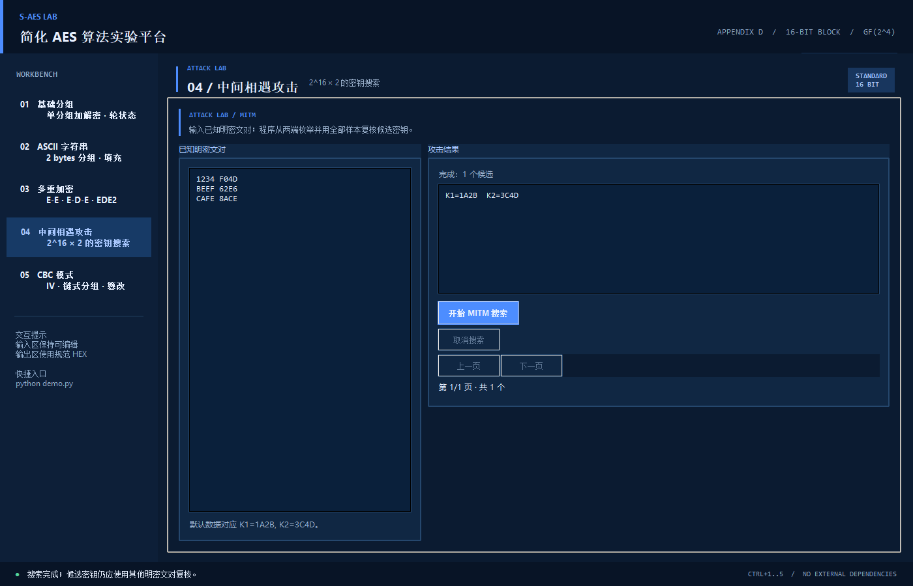
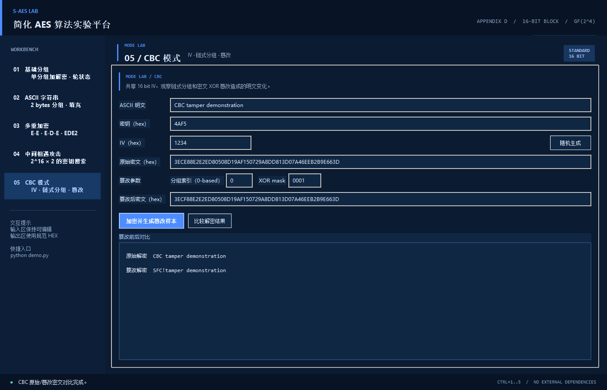

# 用户指南

## 1. 环境与启动

本项目需要 Python 3.10 或更高版本。项目不依赖第三方 Python 库；GUI 需要 Tkinter/Tcl/Tk。当前实测环境为 Windows、Python 3.13.7，其他操作系统尚未实测。可用 `python -m tkinter` 检查 GUI 环境。

在项目根目录执行：

```text
python app.py
```

Windows 也可以双击 `run.bat`。

如果命令行希望复现结果，可以使用：

```text
python saes_cli.py self-test
python demo.py
```

## 2. 基础分组标签页

输入数据和密钥均为 16 bit 十六进制数，例如 `D728`、`4AF5`。点击“加密”得到密文；解密时将密文填回“数据”框，再点击“解密”。右侧会列出加密过程中的状态，便于对照附录 D 的 `SubNib`、`ShiftRow`、`MixColumn` 和轮密钥。

默认交叉测试数据为：

```text
明文 P = D728
密钥 K = 4AF5
密文 C = 24EC
```

已与另一组 C++ 程序实际核对该向量及其他样本，记录见 [交叉测试报告](tests/cross-test/report.md)。



## 3. ASCII 字符串标签页

输入仅允许 ASCII 字符。程序以 2 bytes 为一个 S-AES 分组，并自动使用 2-byte PKCS#7 填充：

| 原文长度对 2 取模 | 添加的填充 |
| --- | --- |
| 0 | `02 02` |
| 1 | `01` |

由于密文可能包含不可打印字节，界面同时显示规范 `hex` 和带 `\xNN` 转义的显示结果。解密时将密文 hex 粘贴回“密文”输入框即可。



## 4. 多重加密标签页

可选模式如下：

| 模式 | 公式 | 密钥数量 |
| --- | --- | --- |
| `double` | `E_K2(E_K1(P))` | 2 |
| `eee` | `E_K3(E_K2(E_K1(P)))` | 3 |
| `ede` | `E_K3(D_K2(E_K1(P)))` | 3 |
| `ede2` | `E_K1(D_K2(E_K1(P)))` | 2 |

`double` 和 `ede2` 模式禁用K3输入框。

`ede2` 对应作业中 32 bit `Key(K1+K2)` 的三重 E-D-E 扩展；`ede` 对应 48 bit 三密钥方案。输入仍然是 16 bit 分组，K1/K2/K3 分别为 16 bit。



## 5. 中间相遇攻击标签页

每行填写一个已知明密文对，格式可以是：

```text
1234 F04D
BEEF 62E6
CAFE 8ACE
```

也支持 `1234:F04D` 或 `1234,F04D`。程序先枚举全部 K1 并存储 `E_K1(P)`，再枚举全部 K2 计算 `D_K2(C)`，最后用所有输入的明密文对复核候选。一个明密文对可能产生多个候选，可增加不同明文对应的数据对以过滤候选。



搜索可取消；结果每页最多100个候选，可翻页浏览。命令行 `--max-results N` 限制候选数，N须为正整数；达到上限时结果可能不完整。

## 6. CBC 标签页

输入 ASCII 明文、16 bit 密钥和 16 bit IV，点击“加密并生成篡改样本”。IV 可以手动输入，也可以随机生成。解密双方必须共享相同的 IV；实际传输时应将 IV 与密文一起保存或发送。

篡改参数为：

- 分组索引从 0 开始；
- `XOR mask` 是对选中密文分组执行的 16 bit 异或值；
- 点击“比较解密结果”后，可直接观察篡改前后明文差异。

CBC 解密关系为：

```text
P_i = D_K(C_i) XOR C_(i-1), 其中 C_0 = IV
```

因此修改 `C_i` 会破坏当前明文分组，并使下一明文分组发生对应的位翻转。CBC 本身不能提供完整性认证，真实系统还必须使用 MAC 或 AEAD。



重新加密会清空旧结果；比较失败时保留密文输入并清空派生结果。

跨程序交换CBC密文须统一填充。本项目使用PKCS#7，对方使用补零，不能直接互通。

## 7. 输入错误

程序会拒绝超出 16 bit 的数据、非法十六进制字符、非 ASCII 文本、非偶数长度的密文字节串和错误填充。错误会显示在状态栏并弹出说明，不会静默产生错误结果。
